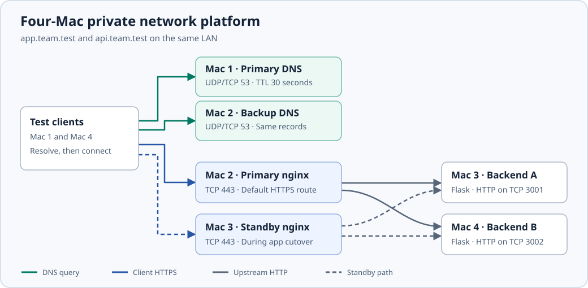

# Private Network Service Platform

A four-Mac Computer Networks project covering Phase 1 and Phase 2. Clients
resolve `app.team.test` and `api.team.test`, connect to nginx over HTTPS, and
get a response from one of two Flask backends.

## Architecture



| Mac | Owner | Roles |
| --- | --- | --- |
| 1 | Aryan Kinha | Primary DNS, deployment controller, test client |
| 2 | Divyanshu Singh | Backup DNS, primary nginx edge |
| 3 | Jatin Verma | Standby nginx edge, Backend A on TCP 3001 |
| 4 | Jatin Kumar Singh | Backend B on TCP 3002, test client |

DNS returns the edge address over UDP or TCP 53. The client makes a separate
HTTPS connection on TCP 443. nginx terminates TLS and forwards HTTP to a
backend. `X-Edge` identifies the nginx instance and `X-Backend` identifies the
backend. The [architecture guide](docs/architecture.md) shows the request flow,
DNS cutover, and original Phase 1 diagram.

## Present the project

Run on Mac 1 from the project checkout. Start with the topology above,
then run the presentation command and open the packet capture.

```sh
./scripts/demo.sh           # Show the command menu
./scripts/demo.sh present   # Show roles, DNS, HTTPS, A/B rotation and cache 304
```

To show the protocols one at a time, run these on a configured client:

```sh
dig app.team.test +noall +answer
curl --http1.1 -fsS -i https://app.team.test/api/status
./scripts/smoke-test.sh team.test
```

In the output, point out the **30-second DNS TTL**, **verified HTTP/1.1
response**, **alternating A/B backend IDs**, and **304 on cache revalidation**.
Open the [LAN capture and frame guide](evidence/phase2/README.md) to connect
those results to the DNS answer, TCP handshake, and TLS handshake in Wireshark.

### Phase 2 demonstrations

Run a scenario when the evaluator asks to see it. The service-changing
drills should be run one at a time.

| Command on Mac 1 | What to show |
| --- | --- |
| `./scripts/demo.sh A` | Stop primary DNS, show the backup reply, and restore primary DNS. |
| `sudo -v` then `./scripts/demo.sh B --flush` | Compare the cached and fresh addresses, flush the cache, and show the restored record. |
| `./scripts/demo.sh C` | After both backend owners apply the rules, show client denial and edge access. Verify recovery with `C --restored` after rollback. |
| `./scripts/demo.sh D` | Show eight B-only requests with A stopped, then A/B rotation after A returns. |
| `./scripts/demo.sh E` | Compare cached and fresh clients during standby cutover, then show the rollback. |
| `./scripts/demo.sh diagnose` | Locate the faculty-injected fault. Use `./scripts/demo.sh F` for a rehearsal with recovery. |

The [presentation sequence](docs/demo-commands.md) follows the course brief.
The [runbook](docs/phase2-runbook.md) includes owner-side commands and recovery.
The [submission checklist](docs/form-submission-checklist.md) records which
checks still need live evidence.

## Set up or verify the lab

On Mac 1, keep the live LAN values in the ignored `team/team.env`, based on
[the example](team/team.env.example). For a planned deployment:

```sh
./scripts/deploy.sh --check
./scripts/deploy.sh --all --dry-run
./scripts/deploy.sh --all
```

The last command stages and activates a committed revision. Provision the
team TLS files on a fresh edge first. For the already running lab,
`./scripts/demo.sh check` collects full application verification and
`./scripts/demo.sh baseline` also checks the directed ping matrix.

## Submission material

- [IEEE report (PDF)](docs/report/project-report.pdf) · [LaTeX source](docs/report/project-report.tex) · [Submission and evidence index](docs/submission.md)
- [Phase 1 failure drills](docs/phase1-failure-tests.md) and [historical Phase 1 evidence](evidence/phase1/README.md)
- [TLS setup](docs/tls-setup.md), [troubleshooting](docs/troubleshooting.md), and [viva preparation](docs/viva-preparation.md)

The command menu and compact presentation output draw on
[Antik's network-platform demo script](https://github.com/antik1108/Private-Network-Service-Platform-/blob/93498242a2a2ec5a48056a097bb30dc4d3beff2f/scripts/demo.sh).
