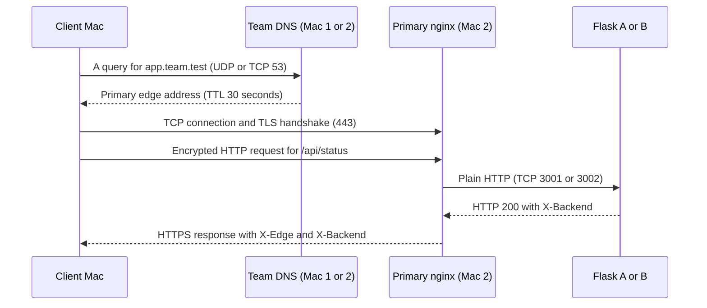
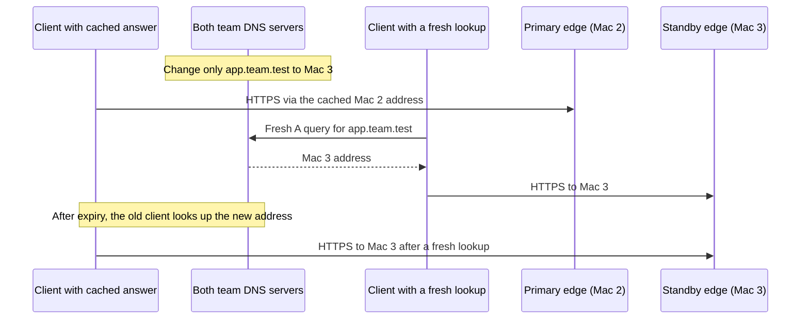

# Architecture and request flow

`team/team.env` holds the live addresses, SSH usernames, subnet, gateway, active
interface, ports, and upstream resolvers. The example inventory contains lab
placeholders. Use the [recorded address inventory](../evidence/phase2/baseline.txt)
for the November evidence and the local file for the current LAN values.

| Node | Roles | Runtime |
| --- | --- | --- |
| Mac 1 | Operator, client, primary DNS | Local execution, dnsmasq on UDP/TCP 53 |
| Mac 2 | Primary nginx, backup DNS | TLS on TCP 443, HTTP redirect on 80, dnsmasq on UDP/TCP 53 |
| Mac 3 | Backend A, standby nginx | TCP 3001, TLS on TCP 443, HTTP redirect on 80 |
| Mac 4 | Backend B, client | TCP 3002 |

## One request through the lab

Both resolvers normally return the primary edge for `app.team.test` and
`api.team.test`. The TTL is 30 seconds. The cutover changes the app record on
both resolvers and leaves the API record on the primary. DNS answers identify a
destination. The client then opens a TCP connection and authenticates the
hostname through TLS. nginx terminates TLS and forwards plain HTTP. The
`X-Edge` and `X-Backend` response headers identify the two service hops.

The strict isolation demonstration admits Mac 2 to both backend ports plus Mac
3's loopback connection to its own Backend A. The standby profile adds the
Mac 3 LAN source to Backend B on Mac 4. Mac 1 is the outside client for both
denial checks. Mac 2 remains a shared dependency for the primary edge and
backup DNS. A DNS cutover needs both a reachable standby and time for old
answers to expire.

## DNS cutover

The rollback restores the app record to Mac 2 and verifies client convergence.
The API record stays on Mac 2 throughout the drill.

## Original Phase 1 topology

The diagram shows the October addressing and roles. See the [Phase 1 results](phase1-results.md)
for the original verification.
